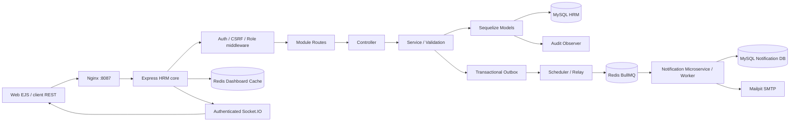

# Module + MVC, ORM và service

Các module nghiệp vụ nằm ở `src/modules`: employees, departments, leaves, attendance, auth, dashboard. Model ORM và association đặt ở `src/models/index.js` dùng chung để tránh định nghĩa chồng quan hệ. Views EJS trả HTML; REST controller trả JSON. Helpers trong lib là thư viện nội bộ project; không phải npm package riêng.

Các route web tại app.js đóng vai web controller render EJS; REST tách route/controller/service. Service kiểm tra nghiệp vụ và transaction; observer tự ghi audit. Không dùng `sequelize.sync()` tạo bảng: migration là nguồn schema, chạy trước server.

## Một luồng tạo nhân viên

POST /api/employees → authenticate → CSRF (cookie) → allow(admin,hr) → controller → Zod → transaction(User, Employee, observer audit, Outbox) → commit → publish nội bộ (invalidate cache, Socket) → response 201.

Scheduler lấy pending outbox → BullMQ jobId=UUID → Notification Worker → DB notification (eventId unique) → Nodemailer → Mailpit → status sent. HRM không cần service notification đang sống để commit nghiệp vụ.

## Ranh giới microservice

HRM dùng `week7_hrm` / user `week7_hrm`. Notification dùng `week7_hrm_notifications` / user `week7_notify`; quyền DB không chéo. Cùng MySQL instance Docker để tiết kiệm máy, nhưng schema/user riêng. Notification có package.json, lockfile, migration, Dockerfile và process độc lập; không import model core. Queue job contract là eventId/topic/recipient/userId/subject/text. Core đọc thông báo qua endpoint nội bộ có INTERNAL_KEY; browser không biết khóa này.

## Giới hạn có chủ đích

Đây là HRM học tập gồm hồ sơ/phòng ban/chấm công/nghỉ phép; chưa tính payroll, thuế, bảo hiểm, số dư phép năm, ca kíp, upload tài liệu hoặc SSO. Không phải sản phẩm HRM doanh nghiệp hoàn chỉnh.

SMTP có cửa sổ gửi trùng nếu process chết sau khi SMTP nhận nhưng trước khi update sent; at-least-once, Message-ID cố định, không cam kết exactly-once. Job fail hết retry được giữ lại; outbox queued nghĩa đã vào queue, không đồng nghĩa email sent. UI system phân biệt queue state.

Cache có TTL 30 giây và invalidate sau mutation. Cache fail thì đọc DB; nếu Redis hỏng đúng lúc invalidate, cache cũ có thể tồn tại tới TTL sau khi Redis phục hồi. Relay nhiều process có thể đọc cùng outbox nhưng jobId chống thêm trùng trong thời gian retention. Scheduler digest unique theo ngày. Chưa có audit archive/retention cho dữ liệu dài hạn.

Realtime hiện một instance web, chưa có Socket.IO Redis adapter để scale nhiều app. Socket bị đóng lúc token hết hạn và recheck role/version 15 giây; payload broadcast chỉ tên sự kiện, không có hồ sơ/lương. Không claim production-ready hoặc đã deploy Internet.

Demo cookies HttpOnly, SameSite=Lax; JWT expiry 8 giờ, logout thu hồi mọi phiên user, password/role/active thay đổi tăng tokenVersion. Khi public cần HTTPS, COOKIE_SECURE=true, APP_ORIGIN chính xác, secret thật, thay tài khoản/password demo, SMTP thật và chính sách backup. Không đưa khóa vào git.
